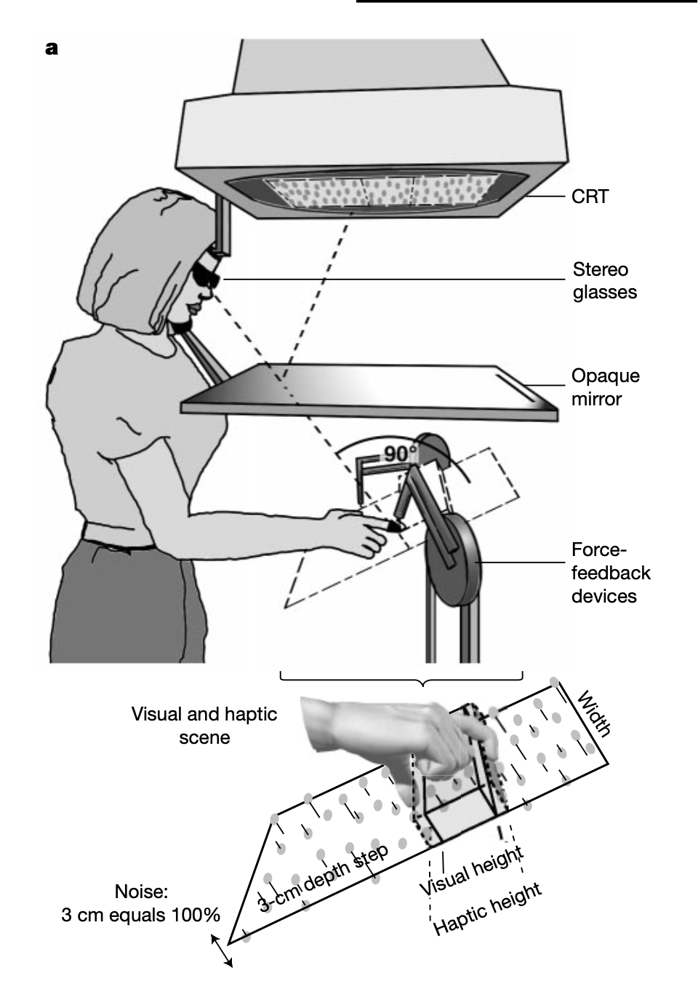

```{r}
#| echo: false
#| message: false
#| warning: false
library(ggplot2)
library(tidyr)
set.seed(42)
```

## Obiettivi {.unnumbered .unlisted}

1. Introdurre la coppia coniugata **Normale-Normale**.
2. Capire come stimare la **media** di una variabile continua.
3. Vedere come prior e dati si **bilanciano**.
4. Applicare il modello a esempi psicologici concreti.


# Parte 1: dal discreto al continuo

## Ripasso: Beta-Binomiale

Nel segmento precedente abbiamo visto la prima famiglia coniugata:

- **dati:** successi/insuccessi (discreti, binari);
- **parametro:** probabilità $\theta \in [0, 1]$;
- **prior:** Beta($\alpha$, $\beta$);
- **posterior:** Beta($\alpha + k$, $\beta + n - k$).

L'aggiornamento si riduceva a **sommare conteggi**. Ma cosa succede con **dati continui**?

---

## Il nuovo scenario

In psicologia spesso abbiamo variabili continue:

- punteggi dei test (es. BDI per depressione: 0-63);
- tempi di reazione (in millisecondi);
- misure fisiologiche (frequenza cardiaca, cortisolo);
- scale Likert aggregate.

**Domanda:** come stimiamo la media $\mu$ di queste variabili con l'approccio bayesiano?

---

## Il modello Normale-Normale

. . .

**Assunzione sui dati:**

$$
y_i \sim \text{Normale}(\mu, \sigma^2).
$$

I dati sono normalmente distribuiti con media $\mu$ (sconosciuta) e varianza $\sigma^2$ (per ora, nota).

. . .

**Prior sulla media:**

$$
\mu \sim \text{Normale}(\mu_0, \sigma_0^2).
$$

---

## Perché è una famiglia coniugata?

. . .

Se i dati sono Normali con media $\mu$ e il prior su $\mu$ è Normale, allora il **posterior su $\mu$ è ancora Normale**:

$$
\mu \mid \text{dati} \sim \text{Normale}(\mu_{\text{post}}, \sigma_{\text{post}}^2).
$$

. . .

Il meccanismo è analogo alla Beta-Binomiale: la forma si conserva e bastano poche operazioni aritmetiche per calcolare i nuovi parametri.

# Parte 2: la formula dell'aggiornamento

## I parametri del posterior

Data un'osservazione $\bar{y}$ (media campionaria) basata su $n$ dati:

**Media del posterior:**

$$
\mu_{\text{post}} = \frac{\frac{\mu_0}{\sigma_0^2} + \frac{n \bar{y}}{\sigma^2}}{\frac{1}{\sigma_0^2} + \frac{n}{\sigma^2}}
$$

**Varianza del posterior:**

$$
\sigma_{\text{post}}^2 = \frac{1}{\frac{1}{\sigma_0^2} + \frac{n}{\sigma^2}}
$$

---

## Formula semplificata: media ponderata


. . .


La media del posterior è una **media ponderata** tra prior e dati:

$$
\mu_{\text{post}} = w \cdot \mu_0 + (1 - w) \cdot \bar{y}
$$

. . .

dove il peso del prior è:

$$
w = \frac{\sigma^2 / n}{\sigma_0^2 + \sigma^2 / n}
$$

. . .

Nella Beta-Binomiale, l'aggiornamento si faceva sommando conteggi. Nella Normale-Normale, l'aggiornamento è una **media ponderata** — dove i pesi dipendono dalle **precisioni** relative.

---

## L'intuizione: chi "vince"? {background-color="#2c3e50" style="color: white;"}

. . .

Il posterior è un **compromesso** tra ciò che credevamo prima ($\mu_0$) e ciò che dicono i dati ($\bar{y}$).

. . .

- Se il prior è **impreciso** ($\sigma_0^2$ grande): i dati dominano.
- Se il prior è **preciso** ($\sigma_0^2$ piccolo): il prior resiste.
- Se abbiamo **molti dati** ($n$ grande): i dati dominano.

. . .

È lo stesso principio che abbiamo visto con la Beta-Binomiale: la "forza" del prior ($\alpha + \beta$ nel caso Beta, $1/\sigma_0^2$ nel caso Normale) compete con la "forza" dei dati ($n$ osservazioni). Con abbastanza dati, il posterior converge verso la media campionaria.

---

## Visualizziamo l'intuizione

```{r}
#| echo: false
#| fig-height: 5

x <- seq(-4, 8, length.out = 300)

# Prior: N(0, 2²)
prior <- dnorm(x, mean = 0, sd = 2)

# Verosimiglianza: basata su media campionaria = 4, n = 5, sigma = 2
likelihood <- dnorm(x, mean = 4, sd = 2/sqrt(5))

# Calcolo dei parametri posteriori
sigma0_sq <- 4
sigma_sq <- 4
n_es <- 5
ybar_es <- 4

prec_prior <- 1/sigma0_sq
prec_data <- n_es/sigma_sq
prec_post <- prec_prior + prec_data

mu_post_es <- (prec_prior * 0 + prec_data * ybar_es) / prec_post
sigma_post_es <- sqrt(1/prec_post)

posterior <- dnorm(x, mean = mu_post_es, sd = sigma_post_es)

# Normalizzazione per sovrapporre le curve
df_intro <- data.frame(
  x = rep(x, 3),
  densita = c(prior / max(prior), likelihood / max(likelihood), posterior / max(posterior)),
  tipo = rep(c("Prior: N(0, 4)", "Verosimiglianza", "Posterior"), each = length(x))
)

df_intro$tipo <- factor(df_intro$tipo, levels = c("Prior: N(0, 4)", "Verosimiglianza", "Posterior"))

ggplot(df_intro, aes(x = x, y = densita, color = tipo)) +
  geom_line(linewidth = 1.2) +
  scale_color_manual(values = c("steelblue", "forestgreen", "coral")) +
  labs(
    title = "Aggiornamento Normale-Normale",
    subtitle = paste0("Prior: μ0 = 0 | Dati: ȳ = 4, n = 5 | Posterior: μ = ",
                      round(mu_post_es, 2)),
    x = expression(mu), y = "Densità (normalizzata)", color = ""
  ) +
  theme_minimal(base_size = 14) +
  theme(legend.position = "bottom")
```

# Parte 3: la stima della depressione media

## Scenario: punteggi al BDI-II

Uno psicologo clinico vuole stimare il livello medio di depressione in un gruppo di pazienti usando il **Beck Depression Inventory-II** (BDI-II, range 0-63).

. . .

**Conoscenza pregressa (prior):**

- la letteratura indica che pazienti con depressione moderata hanno punteggi medi intorno a 25;
- c'è incertezza: potrebbe variare tra 20 e 30.

---

## Traduciamo in un prior

**Prior:** $\mu \sim \text{Normale}(25, 5^2)$

- media: $\mu_0 = 25$ (valore atteso dalla letteratura);
- deviazione standard: $\sigma_0 = 5$ (incertezza: $\pm 10$ punti copre ~95%).

```{r}
mu0 <- 25
sigma0 <- 5

cat("Prior: Normale(", mu0, ",", sigma0^2, ")\n")
cat("Intervallo 95% prior: [", round(mu0 - 1.96*sigma0, 1), ",", 
    round(mu0 + 1.96*sigma0, 1), "]")
```

---

```{r}
#| echo: false
#| fig-height: 5

x_prior <- seq(mu0 - 4*sigma0, mu0 + 4*sigma0, length.out = 300)
y_prior <- dnorm(x_prior, mean = mu0, sd = sigma0)
lower_bound <- mu0 - 1.96*sigma0
upper_bound <- mu0 + 1.96*sigma0

df_prior <- data.frame(x = x_prior, y = y_prior)

ggplot(df_prior, aes(x = x, y = y)) +
  geom_line(color = "steelblue", linewidth = 1.5) +
  geom_area(
    data = subset(df_prior, x >= lower_bound & x <= upper_bound),
    fill = "steelblue", alpha = 0.3
  ) +
  geom_vline(xintercept = mu0, color = "darkblue", linewidth = 1) +
  geom_vline(xintercept = c(lower_bound, upper_bound), 
             color = "darkblue", linewidth = 0.7, linetype = "dashed") +
  annotate("label", x = mu0, y = max(y_prior)*0.5, label = "95%",
           color = "darkblue", fill = "white", alpha = 0.8) +
  labs(title = expression(paste("Distribuzione a priori: ", mu, " ~ N(25, 25)")),
       subtitle = paste0("Intervallo al 95%: [", round(lower_bound, 1), 
                        ", ", round(upper_bound, 1), "]"),
       x = expression(paste("Valore possibile di ", mu)),
       y = "Densità di probabilità") +
  theme_minimal(base_size = 14)
```

---

## I dati

Lo psicologo raccoglie dati da **n = 12** pazienti. Assumiamo che la variabilità individuale ($\sigma$) sia nota dalla letteratura: $\sigma = 8$.

```{r}
# Dati simulati (punteggi BDI-II)
punteggi <- c(28, 32, 24, 29, 35, 27, 31, 26, 30, 28, 33, 29)

n <- length(punteggi)
ybar <- mean(punteggi)
sigma <- 8

cat("Numero pazienti:", n, "\n")
cat("Media campionaria:", round(ybar, 2), "\n")
```

---

## Calcoliamo il posterior

```{r}
# Precisioni (inverso della varianza)
prec_prior <- 1 / sigma0^2
prec_dati <- n / sigma^2
prec_post <- prec_prior + prec_dati

# Media del posterior
mu_post <- (prec_prior * mu0 + prec_dati * ybar) / prec_post

# SD del posterior
sigma_post <- sqrt(1 / prec_post)

cat("Posterior: Normale(", round(mu_post, 2), ",", round(sigma_post^2, 2), ")\n")
cat("Media posterior:", round(mu_post, 2), "\n")
cat("SD posterior:", round(sigma_post, 2), "\n")
```

---

## I tre ingredienti

```{r}
#| echo: false
#| fig-height: 5

x_bdi <- seq(10, 45, length.out = 300)

df_bdi <- data.frame(
  x = rep(x_bdi, 3),
  densita = c(dnorm(x_bdi, mu0, sigma0), 
              dnorm(x_bdi, ybar, sigma/sqrt(n)),
              dnorm(x_bdi, mu_post, sigma_post)),
  tipo = rep(c("Prior", "Verosimiglianza", "Posterior"), each = length(x_bdi))
)

df_bdi$tipo <- factor(df_bdi$tipo, levels = c("Prior", "Verosimiglianza", "Posterior"))

ggplot(df_bdi, aes(x = x, y = densita, color = tipo)) +
  geom_line(linewidth = 1.2) +
  scale_color_manual(values = c("steelblue", "forestgreen", "coral")) +
  labs(title = "Stima del punteggio medio BDI-II",
       subtitle = paste0("Prior: μ = 25 | Dati: ȳ = ", round(ybar, 1), 
                        " (n = 12) | Posterior: μ = ", round(mu_post, 1)),
       x = "Punteggio BDI-II medio (μ)", y = "Densità", color = "") +
  theme_minimal(base_size = 14) +
  theme(legend.position = "bottom")
```

---

## Interpretazione dei risultati

**Prior:** media attesa = 25, SD = 5.

**Dati:** media osservata = `r round(ybar, 1)`, n = 12.

**Posterior:** media stimata = `r round(mu_post, 1)`, SD = `r round(sigma_post, 1)`.

. . .

Il posterior è un compromesso: più vicino ai dati (`r round(ybar, 1)`) che al prior (25) e molto più preciso (SD = `r round(sigma_post, 1)` vs 5).

---

## Intervallo di credibilità al 95%

```{r}
# Intervallo di credibilità
ci_low <- mu_post - 1.96 * sigma_post
ci_high <- mu_post + 1.96 * sigma_post
cat("Intervallo di credibilità 95%: [", round(ci_low, 2), ",", round(ci_high, 2), "]\n")
```

---

```{r}
#| echo: false
#| fig-height: 5

x_post <- seq(mu_post - 4*sigma_post, mu_post + 4*sigma_post, length.out = 300)
y_post <- dnorm(x_post, mean = mu_post, sd = sigma_post)

df_post <- data.frame(x = x_post, y = y_post)

ggplot(df_post, aes(x = x, y = y)) +
  geom_line(color = "coral", linewidth = 1.5) +
  geom_area(
    data = subset(df_post, x >= ci_low & x <= ci_high),
    fill = "coral", alpha = 0.25
  ) +
  geom_vline(xintercept = mu_post, color = "darkred", linewidth = 1) +
  geom_vline(xintercept = c(ci_low, ci_high), color = "darkred", 
             linewidth = 0.8, linetype = "dashed") +
  annotate("label", x = mu_post, y = max(y_post)*0.5,
           label = "Intervallo di credibilità 95%",
           color = "darkred", fill = "white", alpha = 0.85, fontface = "bold") +
  labs(title = expression(paste("Distribuzione a posteriori di ", mu)),
       subtitle = paste0("N(", round(mu_post, 2), ", ", round(sigma_post^2, 2), 
                        ") | 95% CI: [", round(ci_low, 2), ", ", round(ci_high, 2), "]"),
       x = expression(paste("Valore di ", mu)),
       y = "Densità di probabilità") +
  theme_minimal(base_size = 14)
```

---

## Domanda clinica {background-color="#2c3e50" style="color: white;"}

> "Qual è la probabilità che il punteggio medio sia > 28 (depressione moderata-grave)?"

. . .

```{r}
prob_gt_28 <- 1 - pnorm(28, mean = mu_post, sd = sigma_post)
cat("P(μ > 28) =", round(prob_gt_28 * 100, 1), "%")
```

. . .

C'è circa il **`r round(prob_gt_28 * 100, 1)`%** di probabilità che il gruppo abbia depressione moderata-grave. Questa è una probabilità diretta sul parametro — non un valore-$p$, non una procedura ripetuta: è una risposta diretta alla domanda che il clinico si pone.

---

## Interpretazione finale 

**Prima dei dati (prior):** pensavamo a un gruppo con depressione moderata, con punteggio medio atteso intorno a 25 (ampia incertezza: circa 20-30).

**Dopo i dati (posterior):** la stima del punteggio medio sale a circa `r round(mu_post, 1)`, con un intervallo di credibilità al 95% di circa [`r round(ci_low, 1)`, `r round(ci_high, 1)`].

. . .

I dati spostano in modo sostanziale la nostra valutazione verso livelli più elevati di depressione, ma manteniamo una quantificazione esplicita dell'incertezza residua.

# Parte 4: l'effetto della dimensione campionaria

## Cosa succede con più dati?

Confrontiamo tre scenari (stessa media campionaria $\bar{y}$ = 29.3):

- $n$ = 5 (pochi dati);
- $n$ = 12 (dati moderati);
- $n$ = 50 (molti dati).

---

## Calcolo per i tre scenari

```{r}
calcola_posterior <- function(mu0, sigma0, ybar, sigma, n) {
  prec_prior <- 1 / sigma0^2
  prec_dati <- n / sigma^2
  prec_post <- prec_prior + prec_dati
  
  mu_post <- (prec_prior * mu0 + prec_dati * ybar) / prec_post
  sigma_post <- sqrt(1 / prec_post)
  
  list(mu = mu_post, sigma = sigma_post)
}
```

---

```{r}
post_n5 <- calcola_posterior(25, 5, 29.3, 8, 5)
post_n12 <- calcola_posterior(25, 5, 29.3, 8, 12)
post_n50 <- calcola_posterior(25, 5, 29.3, 8, 50)
```

. . .

```{r}
cat("n = 5:  μ =", round(post_n5$mu, 2), ", σ =", round(post_n5$sigma, 2), "\n")
cat("n = 12: μ =", round(post_n12$mu, 2), ", σ =", round(post_n12$sigma, 2), "\n")
cat("n = 50: μ =", round(post_n50$mu, 2), ", σ =", round(post_n50$sigma, 2), "\n")
```

---

```{r}
#| echo: false

x_n <- seq(10, 45, length.out = 300)

df_n <- data.frame(
  x = rep(x_n, 4),
  densita = c(dnorm(x_n, mu0, sigma0),
              dnorm(x_n, post_n5$mu, post_n5$sigma),
              dnorm(x_n, post_n12$mu, post_n12$sigma),
              dnorm(x_n, post_n50$mu, post_n50$sigma)),
  tipo = rep(c("Prior", "n = 5", "n = 12", "n = 50"), each = length(x_n))
)

df_n$tipo <- factor(df_n$tipo, levels = c("Prior", "n = 5", "n = 12", "n = 50"))

ggplot(df_n, aes(x = x, y = densita, color = tipo)) +
  geom_line(linewidth = 1.2) +
  geom_vline(xintercept = 29.3, linetype = "dashed", color = "gray40") +
  labs(title = "Effetto della dimensione campionaria",
       subtitle = "Stessa media campionaria (ȳ = 29.3), diverso n",
       x = "μ", y = "Densità", color = "") +
  theme_minimal(base_size = 14) +
  theme(legend.position = "bottom") +
  annotate("text", x = 30, y = 0.5, label = "ȳ = 29.3", color = "gray40")
```

---

## Interpretazione

Con più dati:

1. la media del posterior si **avvicina** alla media campionaria;
2. la varianza del posterior **diminuisce** (più precisione);
3. l'influenza del prior **svanisce**.

È lo stesso principio che abbiamo visto in tutte le lezioni precedenti: 

. . .

con abbastanza evidenza, i dati vincono sempre.

# Parte 5: *cue-combination* — la mente come statistico bayesiano

## Come vediamo il mondo?

Lo studio di Ernst e Banks (2002) pubblicato su *Nature* offre un'elegante dimostrazione di come la mente combini informazioni provenienti da sensi diversi — in questo caso vista e tatto — per costruire una percezione unificata del mondo. 

. . .

La domanda centrale è: quando guardiamo un oggetto e contemporaneamente lo tocchiamo, come decide la mente quale senso "fidarsi" di più?

---

## L'intuizione chiave

La mente si comporta come uno statistico bayesiano ottimale: pesa le informazioni di ciascun senso in base alla loro **affidabilità** (cioè, l'inverso della varianza). Se la vista fornisce informazioni precise, domina la percezione; se la vista è perturbata, il tatto assume un ruolo più importante.

. . .

Questo è esattamente il principio della **media ponderata** che abbiamo appena studiato nella Normale-Normale.

---

## Il parallelo con l'inferenza bayesiana

Nello studio di Ernst e Banks:

- l'informazione **tattile** funziona come il "prior" — una stima iniziale dell'altezza;
- l'informazione **visiva** porta nuove evidenze (come i "dati");
- la **percezione finale** è il posterior — una combinazione pesata delle due fonti.

---

## Il metodo sperimentale

I partecipanti dovevano giudicare l'altezza di una barra orizzontale che potevano sia vedere (attraverso uno schermo stereoscopico) sia toccare (usando dispositivi a feedback di forza -- *force feedback*).

---

::: {#fig-like}
{width="80%"}

Apparato sperimentale (Ernst & Banks, 2002).
:::

---

## La manipolazione sperimentale

L'aspetto ingegnoso dell'esperimento era che i ricercatori potevano manipolare indipendentemente:

1. l'**altezza specificata dalla vista** (ciò che i partecipanti vedevano);
2. l'**altezza specificata dal tatto** (ciò che i partecipanti sentivano);
3. il **livello di rumore visivo** (perturbazioni casuali nello stereogramma).

---

## Il risultato chiave

Quando il rumore visivo aumentava, la vista diventava meno affidabile e la percezione si spostava verso l'informazione tattile — esattamente come predetto dalla regola di aggiornamento bayesiano.

---

## Un esempio numerico

```{r}
#| echo: false

sigma_tatto <- 4.7   # mm
sigma_vista <- 2.2   # mm
altezza_tatto <- 55  # mm
altezza_vista <- 58  # mm

# Calcolo dei pesi
prec_tatto <- 1 / sigma_tatto^2
prec_vista <- 1 / sigma_vista^2
prec_totale <- prec_tatto + prec_vista

w_vista <- prec_vista / prec_totale
w_tatto <- prec_tatto / prec_totale

# Percezione combinata
percezione_combinata <- w_vista * altezza_vista + w_tatto * altezza_tatto
sigma_combinata <- sqrt(1 / prec_totale)
```

Immaginiamo che un partecipante tocchi una barra alta **`r altezza_tatto` mm** ma la veda come alta **`r altezza_vista` mm**.

Se la vista è più precisa del tatto (SD = `r sigma_vista` mm vs `r sigma_tatto` mm), la formula bayesiana assegna: peso della vista `r round(w_vista * 100)`%, peso del tatto `r round(w_tatto * 100)`%.

---

## La percezione combinata

```{r}
#| echo: false

x_ernst <- seq(45, 68, length.out = 300)

df_ernst <- data.frame(
  x = rep(x_ernst, 3),
  densita = c(
    dnorm(x_ernst, altezza_tatto, sigma_tatto),
    dnorm(x_ernst, altezza_vista, sigma_vista),
    dnorm(x_ernst, percezione_combinata, sigma_combinata)
  ),
  fonte = rep(c("Tatto (prior)", "Vista (verosimiglianza)", "Percezione (posterior)"), 
              each = length(x_ernst))
)

df_ernst$fonte <- factor(df_ernst$fonte, 
                         levels = c("Tatto (prior)", "Vista (verosimiglianza)", 
                                   "Percezione (posterior)"))

ggplot(df_ernst, aes(x = x, y = densita, color = fonte)) +
  geom_line(linewidth = 1.3) +
  scale_color_manual(values = c("steelblue", "forestgreen", "coral")) +
  labs(
    title = "Integrazione visuo-tattile",
    subtitle = paste0("Tatto: ", altezza_tatto, " mm | Vista: ", altezza_vista, 
                     " mm | Percezione: ", round(percezione_combinata, 1), " mm"),
    x = "Altezza stimata (mm)", y = "Densità", color = ""
  ) +
  theme_minimal(base_size = 14) +
  theme(legend.position = "bottom")
```

--- 

La percezione finale (**`r round(percezione_combinata, 1)` mm**) è un compromesso, più vicino alla vista perché la vista è più precisa.

---

## Il guadagno della combinazione

Combinare le informazioni non solo produce una stima ottimale, ma **riduce l'incertezza**:

| Fonte | Incertezza (SD) |
|-------|-----------------|
| Solo tatto | `r sigma_tatto` mm |
| Solo vista | `r sigma_vista` mm |
| **Combinazione** | **`r round(sigma_combinata, 1)` mm** |

---

La percezione combinata è **più precisa** di entrambi i sensi usati singolarmente. 

. . .

È lo stesso fenomeno che vediamo nell'inferenza bayesiana: il posterior ha sempre varianza minore sia del prior sia della verosimiglianza.

---

## Cosa succede con rumore visivo?

```{r}
#| echo: false

sigma_vista_rumorosa <- 11  # mm

prec_vista_rumorosa <- 1 / sigma_vista_rumorosa^2
prec_totale_rumoroso <- prec_tatto + prec_vista_rumorosa

w_vista_rumorosa <- prec_vista_rumorosa / prec_totale_rumoroso
w_tatto_rumoroso <- prec_tatto / prec_totale_rumoroso

percezione_rumorosa <- w_vista_rumorosa * altezza_vista + w_tatto_rumoroso * altezza_tatto
```

Quando i ricercatori aggiungevano rumore allo stimolo visivo (SD passa da `r sigma_vista` a `r sigma_vista_rumorosa` mm), i pesi cambiavano drasticamente:

| Condizione | Peso vista | Peso tatto |
|------------|------------|------------|
| Senza rumore | `r round(w_vista * 100)`% | `r round(w_tatto * 100)`% |
| Con rumore | `r round(w_vista_rumorosa * 100)`% | `r round(w_tatto_rumoroso * 100)`% |

La percezione si sposta verso il tatto: **`r round(percezione_rumorosa, 1)` mm** (più vicina ai `r altezza_tatto` mm del tatto).

---

## Il parallelo con l'inferenza bayesiana

| Integrazione sensoriale | Inferenza Normale-Normale |
|------------------------|---------------------------|
| Stima tattile | Prior $\mu_0$ |
| Stima visiva | Media campionaria $\bar{y}$ |
| Varianza tattile $\sigma^2_T$ | Varianza del prior $\sigma^2_0$ |
| Varianza visiva $\sigma^2_V$ | Varianza dei dati $\sigma^2/n$ |
| Percezione finale | Posterior $\mu_{\text{post}}$ |

---

## Il messaggio

La mente implementa naturalmente lo stesso principio statistico che usiamo nell'inferenza bayesiana: **pesare le fonti di informazione in base alla loro affidabilità**.

. . .

Questo è il senso profondo della statistica bayesiana: non è solo una tecnica matematica, ma riflette il modo in cui la mente elabora informazioni sul mondo.


# Riepilogo e percorso del corso

## Il percorso fin qui {background-color="#27ae60" style="color: white;"}

. . .

**Lezioni 5-11** — Probabilità, distribuzioni, verosimiglianza.

**Lezioni 14-16** — Inferenza frequentista e crisi di replicabilità.

**Lezione 17** — I tre ingredienti bayesiani. Approssimazione a griglia.

**Lezione 18** — Apprendimento sequenziale. Il posterior diventa il prior.

**Lezione 19 (oggi)** — Le famiglie coniugate: Beta-Binomiale e Normale-Normale. Le scorciatoie analitiche e il parallelo con la percezione.

. . .

Nella prossima lezione impareremo a **riassumere e comunicare** i risultati dell'inferenza bayesiana: media, mediana, intervalli di credibilità e HDI.

---

## Riepilogo 

1. **Normale-Normale:** Prior Normale + dati Normali → Posterior Normale.

2. **Il posterior è una media ponderata** tra prior e dati, con pesi dati dalle precisioni.

3. **La precisione aumenta** con più dati.

4. **Applicabile a variabili continue:** punteggi, tempi, misure fisiologiche.

5. **La mente è bayesiana:** l'integrazione sensoriale segue la stessa logica della media ponderata.

---

## Confronto: Beta-Binomiale vs Normale-Normale

| Aspetto | Beta-Binomiale | Normale-Normale |
|---------|----------------|-----------------|
| Tipo di dati | Discreti (successi/insuccessi) | Continui |
| Parametro | Probabilità $\theta \in [0,1]$ | Media $\mu \in \mathbb{R}$ |
| Prior | Beta($\alpha$, $\beta$) | Normale($\mu_0$, $\sigma_0^2$) |
| Aggiornamento | Somma conteggi | Media ponderata |
| "Forza" prior | $\alpha + \beta$ | $1/\sigma_0^2$ |
| Applicazioni | Tassi di risposta, accuratezza | Punteggi, tempi |

---

## Per la prossima lezione

Materiale di studio: https://ccaudek.github.io/utet-companion/

**Prossimo argomento:**

"Sintesi della distribuzione a posteriori: media, mediana, intervalli di credibilità."

Vedremo come **riassumere** e **comunicare** i risultati dell'inferenza bayesiana — trasformando una distribuzione in decisioni e report scientifici.
